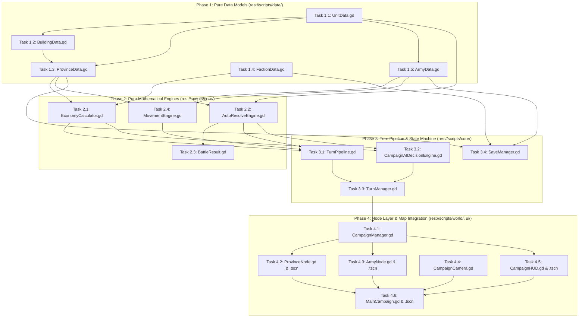

# Phased Atomic Implementation Plan: Sons of Hellas Campaign Engine

This implementation plan synthesizes the specifications from `docs/design/` (`settlement_economy.md`, `movement_stances.md`, `autoresolve_math.md`, `campaign_ai.md`, `data_schemas.md`) and `.agent/rules/mobile_architecture.md`. It strictly adheres to Clean Architecture layers and dependency order, ensuring zero-Node pure data models and mathematical engines are built and tested before application pipeline and presentation layers.

---

## Architectural Dependency Graph

---

## Phase 1: Pure Data Models (Custom Resources & RefCounted)

All models in Phase 1 inherit from `Resource` or `RefCounted`, possess zero `Node` or scene tree dependencies, and enforce strict GDScript static typing and mobile offline constraints.

### Task 1.1: Comprehensive Unit Combat & Role Data Model
* **Target File Path**: `res://scripts/data/UnitData.gd`
* **Description**: Expand `UnitData` to fulfill the full `UnitCard` schema from `docs/design/data_schemas.md`. Implements fine-grained combat attributes, ballistic ammo classifications, role tags for rock-paper-scissors interactions, stamina, mass, recruitment timers, and deep duplication.
* **Concrete Inputs & Expected Outputs**:
  * *Inputs*:
    * Identity: `unit_id = "unit_hoplite_spartan"`, `display_name = "Spartan Hoplites"`, `tier = 2`.
    * Stats: `unit_count = 120`, `melee_attack = 14`, `melee_defense = 18`, `armor = 45`, `charge_bonus = 10`, `missile_accuracy = 0`, `reload_speed = 0`, `missile_range = 0`, `ammo_type = AmmoType.STANDARD_ARROW`, `ammo_capacity = 0`, `morale = 12`, `fatigue_max = 100`, `mass = 2.5`, `veterancy_rank = 3`.
    * Role Tags: `[RoleTag.INFANTRY_SPEAR]`.
    * Economy: `recruitment_cost = 450`, `turn_upkeep = 110`, `recruitment_turn_time = 2`.
  * *Outputs*:
    * `get_combat_value()` returns `float` reflecting base power: $120 \times (14 + 0.6(18) + 0.5(45) + 0.4(10)) \times (1.0 + 0.05(3)) = 120 \times 51.3 \times 1.15 = 7079.4$.
    * `duplicate_unit()` returns an isolated, identical clone with zero shared references.
* **Automated Unit Test Requirements**:
  * `test_unit_data_defaults()`: Verifies default values match schema bounds.
  * `test_unit_data_cloning()`: Asserts changing `unit_count` on cloned unit does not mutate the source resource.
  * `test_unit_combat_value_calculation()`: Validates melee and ranged unit baseline power outputs against expected algebraic values.
  * `test_role_tag_containment()`: Asserts that unit contains valid flags (e.g. `INFANTRY_SPEAR` counters `CAVALRY_LIGHT`).

---

### Task 1.2: Building Infrastructure & Economic Output Model
* **Target File Path**: `res://scripts/data/BuildingData.gd`
* **Description**: Implement `BuildingData` corresponding to `BuildingNode` schema in `docs/design/data_schemas.md`. Encapsulates branch categorization, upgrade tiers, fixed base wealth, per-turn Positive Wealth Generation ($PWG$), empire-wide negative wealth penalties, tax modifier bonuses, food production deltas, garrison unit definitions, and unlock prerequisites.
* **Concrete Inputs & Expected Outputs**:
  * *Inputs*:
    * Identity: `building_id = "bld_rice_exchange_tier2"`, `branch_type = BranchType.INDUSTRY_WEAVING`, `upgrade_level = 2`.
    * Construction: `construction_cost = 850`, `turns_to_build = 3`.
    * Outputs: `base_wealth = 200.0`, `positive_wealth_generation = 5.0`, `negative_wealth_generation_penalty = -1.0`, `tax_modifier_bonus = 0.03`, `food_production_delta = -1`.
    * Garrisons: `garrison_units_granted = [{ "unit": UnitData, "quantity": 1 }]`.
    * Prerequisites: `required_settlement_level = 2`, `required_resource_type = "NONE"`.
  * *Outputs*:
    * `is_unlocked(available_resources: Array[String], current_settlement_level: int)` returns `bool` (`true` when prerequisites met, `false` otherwise).
    * `get_net_food_delta()` returns `int = -1`.
* **Automated Unit Test Requirements**:
  * `test_building_unlock_requirements()`: Fails when settlement level is below required tier; passes when conditions met.
  * `test_negative_wealth_penalty_bounds()`: Asserts negative wealth penalty is $\le 0.0$.
  * `test_garrison_roster_extraction()`: Asserts that querying granted garrison units returns valid `UnitData` entries with positive quantities.

---

### Task 1.3: Province, Settlement Slots & Public Order Data Model
* **Target File Path**: `res://scripts/data/ProvinceData.gd`
* **Description**: Overhaul `ProvinceData` to match `Settlement` schema in `docs/design/data_schemas.md` and `docs/design/settlement_economy.md`. Enforces slot capacity strictly bounded by settlement level (Tier 1 = 1 slot ... Tier 5 = 5 slots). Tracks regional wealth asset base ($W_{\text{region}}$), upper/lower tax policy levels ($L_{\text{tax}} \in [1..5]$), tax exemption flag, population surplus ($P_{\text{surplus}}$), consecutive unrest turn counter, and foreign occupation resistance decay ($U_{\text{conquest}}$).
* **Concrete Inputs & Expected Outputs**:
  * *Inputs*:
    * `province_id = "prov_sparta"`, `settlement_level = 3`, `region_wealth = 1500.0`, `tax_level_upper = 3`, `tax_level_lower = 3`, `tax_exemption_status = false`.
    * Array of 3 building slots: Slot 0 (Palace Level 2), Slot 1 (Barracks Level 2), Slot 2 (Empty).
  * *Outputs*:
    * `can_add_building()` returns `true` (current active count 2 < max slots 3).
    * Attempting to add a building to a full settlement returns `false` and leaves array unchanged.
    * `consecutive_unrest_turns` correctly increments when $PO < 0$, resets to 0 when $PO \ge 0$.
* **Automated Unit Test Requirements**:
  * `test_settlement_slot_capacity_bound()`: Level 1 allows exactly 1 slot; Level 5 allows exactly 5 slots. Adding beyond capacity fails cleanly.
  * `test_tax_level_clamping()`: Tax levels must clamp to integer range $[1, 5]$.
  * `test_consecutive_unrest_increment()`: Asserts turn progression increments unrest counter on negative public order and resets on positive.

---

### Task 1.4: Faction Treasury, Food Network & Bankruptcy Model
* **Target File Path**: `res://scripts/data/FactionData.gd`
* **Description**: Expand `FactionData` to model macroeconomic state: treasury balance, base King's Purse ($I_{\text{purse}} = 3000$), trade routes revenue, vassal tribute, trade raiding income, global food network balance ($F_{\text{net}}$), empire size (held regions count for administration penalty), and bankruptcy state flags.
* **Concrete Inputs & Expected Outputs**:
  * *Inputs*:
    * `treasury = 500`, `base_purse = 3000`, `held_provinces = ["prov_sparta", "prov_corinth"]`.
    * Deducting expense of 800 with `treasury = 500`.
  * *Outputs*:
    * `can_afford(800)` returns `false`.
    * `deduct_treasury(800)` fails safely, or enters bankruptcy mode if forced (`is_bankrupt = true`, `treasury = 0`).
    * `held_provinces.size() = 2` yields `C_admin = 0` (threshold is $> 4$).
* **Automated Unit Test Requirements**:
  * `test_treasury_deduction_and_affordability()`: Boundary checks on zero and negative deductions.
  * `test_global_food_balance_aggregation()`: Asserts that net clan food is summed accurately across all held provinces.
  * `test_bankruptcy_trigger_state()`: Verifies bankruptcy flag is set when expenses exceed funds and treasury drops to 0.

---

### Task 1.5: Army Stance, Command & Action Point Model
* **Target File Path**: `res://scripts/data/ArmyData.gd`
* **Description**: Expand `ArmyData` to model all tactical stances from `docs/design/movement_stances.md` (`NORMAL`, `FORCED_MARCH`, `RAIDING`, `ENCAMPMENT`, `AMBUSH`, `SIEGE`), Action Points pool, General command stars ($0\text{--}10$), passive trait bonuses, and turn retreat tracking flag (`has_retreated_this_turn`).
* **Concrete Inputs & Expected Outputs**:
  * *Inputs*:
    * `current_action_points = 100.0`, `max_action_points = 100.0`, `stance = Stance.NORMAL`.
    * Activating Raiding stance when $AP_{\text{spent}} = 40.0$ ($AP_{\text{rem}} = 60.0 \ge 50\%$).
  * *Outputs*:
    * `set_stance(Stance.RAIDING)` succeeds: $AP_{\text{cost}} = 50.0$, new $AP_{\text{current}} = 10.0$, max AP capped at $0.50 \times 100 = 50.0$.
    * Upkeep calculation under Raiding stance: $U_{\text{raid}} = 0.50 \times U_{\text{base}}$.
    * `has_retreated_this_turn` prevents multiple retreats in a single turn.
* **Automated Unit Test Requirements**:
  * `test_raiding_stance_activation_conditions()`: Fails activation if $AP_{\text{spent}} > 0.50 \times AP_{\text{max}}$.
  * `test_raiding_upkeep_discount()`: Asserts total upkeep is halved under Raiding stance.
  * `test_forced_march_ap_bonus()`: Asserts Forced March increases AP allocation.
  * `test_retreat_flag_lifecycle()`: Asserts flag sets on retreat and resets on turn start.

---

## Phase 2: Pure Mathematical Engines

Phase 2 builds stateless or RefCounted computation engines that execute all formulas from the design specifications. They are 100% testable in isolation without Godot node trees.

### Task 2.1: Settlement Economy & Public Order Math Engine
* **Target File Path**: `res://scripts/core/EconomyCalculator.gd`
* **Description**: Implement the mathematical formulas from `docs/design/settlement_economy.md`:
  * Class tax rates: $T_{\text{class}} = 0.05 \times L_{\text{tax}}$
  * Administrative penalty: $C_{\text{admin}} = 0$ if $N_{\text{regions}} \le 4$, else $(N_{\text{regions}} - 4) \times 0.02$
  * Effective regional tax rate: $T_{\text{local}} = \frac{T_{\text{upper}} + T_{\text{lower}}}{2} + M_{\text{gov}} + M_{\text{minister}} - C_{\text{admin}}$
  * Region tax yield: $I_{\text{tax}} = W_{\text{region}} \times T_{\text{local}}$
  * Wealth decay curves ($NWG$) based on $L_{\text{tax, upper}} \in [1..5]$:
    * L1: $-2 - 0.10 \times PWG$
    * L2: $-4 - 0.20 \times PWG$
    * L3: $-8 - 0.40 \times PWG$
    * L4: $-16 - 0.80 \times PWG$
    * L5: $-32 - 1.20 \times PWG$
  * Net wealth growth: $WG = PWG + NWG$
  * Public order equation: $PO = (R_{\text{garr}} + B_{\text{gov}} + B_{\text{cult}} + B_{\text{tax\_rel}}) - (U_{\text{tax}} + U_{\text{conq}} + U_{\text{ind}} + U_{\text{ref}} + U_{\text{food\_short}})$
* **Concrete Inputs & Expected Outputs**:
  * *Inputs*:
    * $W_{\text{region}} = 2000.0$, $PWG = 20.0$, $L_{\text{tax, upper}} = 3$, $L_{\text{tax, lower}} = 3$, $M_{\text{gov}} = 0.06$, $N_{\text{regions}} = 6$ ($C_{\text{admin}} = 0.04$).
  * *Outputs*:
    * $T_{\text{local}} = 0.15 + 0.06 - 0.04 = 0.17$ ($17\%$).
    * $I_{\text{tax}} = 2000.0 \times 0.17 = 340.0$.
    * $NWG = -8 - (0.40 \times 20.0) = -16.0$.
    * $WG = 20.0 - 16.0 = +4.0$.
    * At Tax Level 5 ($PWG = 20$): $NWG = -32 - 24 = -56.0 \implies WG = -36.0$ (guaranteed economic decay).
* **Automated Unit Test Requirements**:
  * `test_class_tax_rate_scaling()`: Tests $5\%$ linear increments across levels 1 to 5.
  * `test_administrative_penalty_threshold()`: 1 to 4 regions yields 0 penalty; 5+ regions incurs progressive tax decay.
  * `test_tax_level_5_perpetual_decay()`: Asserts $WG < 0$ for any positive $PWG \in [0, 500]$.
  * `test_tax_exemption_zero_tax()`: Tax-exempt provinces produce $0$ tax revenue and $0$ tax unrest.
  * `test_public_order_food_deficit_penalty()`: Severe penalty applied when global clan food balance is negative.

---

### Task 2.2: Automated Combat Resolution (Auto-Resolve) Engine
* **Target File Path**: `res://scripts/core/AutoResolveEngine.gd`
* **Description**: Implement the combat mathematics from `docs/design/autoresolve_math.md`:
  * Melee Combat Value: $S_{\text{melee}} = A_{\text{melee}} + 0.6 D_{\text{melee}} + 0.5 ARM + 0.4 CB$
  * Ranged Combat Value: $S_{\text{missile}} = (\frac{\text{Acc} \times \text{Rld} \times DMG_{\text{proj}} \times (1 + AP_{\text{factor}})}{100}) \times (\frac{R_{\text{range}}}{R_{\text{base}}}) \times \min(1.0, \frac{Ammo}{15})$
  * Unit Base Power: $CP_{\text{base}} = N_{\text{models}} \times (S_{\text{melee}} + S_{\text{missile}}) \times (1.0 + 0.05 \times Rank)$
  * Rock-Paper-Scissors Matchup Matrix ($M_{\text{matchup}}$): Spear vs Cav = 1.75, Cav vs Missile = 1.60, Sword vs Spear = 1.35, Ranged vs Light = 1.30, Matchlock/AP vs Heavy = 1.50, Cav vs Spear = 0.50.
  * Army Modifier Stacking: $CP_{\text{army}} = CP_{\text{total\_raw}} \times M_{\text{gen}} \times M_{\text{morale}} \times M_{\text{fort}} \times M_{\text{env}}$.
  * Logit Win Probability ($\gamma = 2.5$): $P_{\text{win, att}} = \frac{CP_{\text{att}}^{2.5}}{CP_{\text{att}}^{2.5} + CP_{\text{def}}^{2.5}}$.
  * Casualty Distribution & Risk Weighting: $\bar{L}_{\text{victor}} = \min(0.85, 0.40(CP_{\text{loser}} / CP_{\text{victor}})^{1.5})$, $\bar{L}_{\text{loser}} = \min(1.0, 0.60 + 0.40(CP_{\text{victor}} / CP_{\text{loser}}))$, weighted by $W_{\text{risk}, i} \times (ARM_{\text{avg}} / ARM_i)^{0.3}$.
  * Wipeout & Retreat Remnant Rules: Defenders in settlement always destroyed on loss; remnant $< 20\%$ destroyed; 2nd retreat destroyed; else retreat with $AP = 0$.
* **Concrete Inputs & Expected Outputs**:
  * *Inputs*:
    * Attacker Army: $CP_{\text{att}} = 2000.0$.
    * Defender Army: $CP_{\text{def}} = 1000.0$ ($2:1$ power ratio).
  * *Outputs*:
    * $P_{\text{win, att}} = \frac{2^{2.5}}{2^{2.5} + 1^{2.5}} = \frac{5.657}{6.657} \approx 0.850$ ($85.0\%$ win probability).
    * Victor losses: $\bar{L}_{\text{victor}} = 0.40 \times (1000 / 2000)^{1.5} = 0.40 \times 0.3536 \approx 14.1\%$ casualties (classified as Decisive Victory: $R \ge 1.75, \bar{L} \le 20\%$).
    * Defeated army with $15\%$ remaining models $\implies P_{\text{rem}} < 0.20 \implies$ Entire stack shattered/wiped out.
* **Automated Unit Test Requirements**:
  * `test_unit_combat_power_formula()`: Verifies melee and missile power equations with exact values.
  * `test_matchup_multipliers()`: Spear vs Cavalry applies $1.75\times$ bonus; Cavalry vs Spear receives $0.50\times$ penalty.
  * `test_logit_win_probability()`: Asserts $50\%$ at equal power; $85\%$ at $2:1$ ratio.
  * `test_victory_margin_classification()`: Verifies Heroic, Decisive, Close, and Pyrrhic victory conditions.
  * `test_casualty_distribution_risk_weighting()`: Frontline spears suffer higher losses than rear artillery and generals.
  * `test_settlement_siege_defender_wipeout()`: Defending army in siege cannot retreat and is fully destroyed on defeat.

---

### Task 2.3: Battle Result Container & Logging
* **Target File Path**: `res://scripts/core/BattleResult.gd`
* **Description**: Expand `BattleResult` to encapsulate comprehensive combat telemetry: combat powers, logit win probability, victory classification string, victor/loser loss percentages, model casualty counts per unit, remaining survivor rosters, wipeout state, and retreat vector.
* **Concrete Inputs & Expected Outputs**:
  * *Inputs*: Result data populated by `AutoResolveEngine.resolve_battle()`.
  * *Outputs*:
    * `is_decisive()` returns `bool`.
    * `get_log_message()` produces structured markdown log detailing forces, modifiers, and casualty numbers.
* **Automated Unit Test Requirements**:
  * `test_battle_result_formatting()`: Verifies string log output format.
  * `test_battle_result_survivor_integrity()`: Asserts sum of casualties and survivors equals original unit count.

---

### Task 2.4: Campaign Movement, Zone of Control & Raiding Math Engine
* **Target File Path**: `res://scripts/core/MovementEngine.gd`
* **Description**: Implement movement mechanics and stance modifiers from `docs/design/movement_stances.md`:
  * Road infrastructure speed formula: $S_{\text{effective}} = S_{\text{base}} \times (1 + M_{\text{road}})$.
  * AP deduction for movement vectors across terrain.
  * Trade route raid income formula: $I_{\text{raid}} = W_{\text{lane}} \times \alpha_{\text{raid}}$.
  * Zone of Control (ZoC) boundary check: entering hostile ZoC halts movement and flags interception.
  * Retreat vector calculation: $V_{\text{retreat}} = \text{normalize}(P_{\text{defender}} - P_{\text{attacker}}) \times D_{\text{retreat}}$.
* **Concrete Inputs & Expected Outputs**:
  * *Inputs*:
    * Base movement cost $= 40.0$ AP. Road bonus $M_{\text{road}} = 0.50$.
    * Trade lane wealth $W_{\text{lane}} = 800.0$, raid extraction fraction $\alpha_{\text{raid}} = 0.25$.
  * *Outputs*:
    * Road travel cost: $40.0 / (1 + 0.50) \approx 26.67$ AP.
    * Raid yield: $I_{\text{raid}} = 800.0 \times 0.25 = 200.0$ gold deposited.
    * Movement across enemy ZoC returns `interception_triggered = true`.
* **Automated Unit Test Requirements**:
  * `test_road_speed_ap_deduction()`: Movement on paved roads reduces AP consumption proportionally.
  * `test_trade_raiding_extraction()`: Asserts raid revenue calculation matches lane wealth extraction formula.
  * `test_zoc_interception_detection()`: Hostile boundary entry triggers battle interception flag and sets remaining AP to 0.

---

## Phase 3: Turn Pipeline & State Machine

Phase 3 builds the campaign progression state machine and AI decision logic, sequencing phases deterministically while ensuring asynchronous execution for mobile performance.

### Task 3.1: Turn Execution Pipeline Controller
* **Target File Path**: `res://scripts/core/TurnPipeline.gd`
* **Description**: Implement the deterministic 7-step turn execution sequence defined in `docs/design/campaign_ai.md`:
  * **Step 1**: Revenue Collection & Financial Update ($I_{\text{gross}}$, $WG$ delta applied to $W_{\text{region}}$).
  * **Step 2**: Sequential AI Faction Processing.
  * **Step 3**: Construction & Recruitment Timers ($T_{\text{build}} - 1$, spawn completed units/buildings).
  * **Step 4**: AI Strategic Movement & Action Phase.
  * **Step 5**: Conflict Checks & Interception (Field battles, siege declarations, settlement occupation choices).
  * **Step 6**: Upkeep Deductions, Bankruptcy & Attrition Checks.
  * **Step 7**: Public Order Accumulation, Consecutive Unrest Rebellion Spawns, AP Reset, and Season Advance.
* **Concrete Inputs & Expected Outputs**:
  * *Inputs*: Execution trigger on "End Turn".
  * *Outputs*:
    * Emits `step_started(step_index)` and `step_completed(step_index)` for each phase.
    * Completed buildings add stats to province and unlock units.
    * Province with $PO < 0$ for 2 consecutive turns triggers `rebellion_spawned(province, rebel_army)`.
    * All armies have $AP_{\text{current}} = AP_{\text{max}}$ upon Step 7 completion.
* **Automated Unit Test Requirements**:
  * `test_turn_pipeline_step_order()`: Verifies steps execute in strict sequence 1 through 7.
  * `test_construction_timer_countdown()`: Building with 2 turns remaining reaches 1; building at 1 finishes and instantiates.
  * `test_rebellion_spawn_trigger()`: Province at $PO < 0$ on turn 1 triggers warning; remaining negative on turn 2 spawns rebel army.
  * `test_alternating_tax_unrest_reset()`: Alternating tax levels resets consecutive unrest counter, preventing rebellion.

---

### Task 3.2: AI Budgeting, Target Selection & Tactical Scoring Engine
* **Target File Path**: `res://scripts/core/CampaignAIDecisionEngine.gd`
* **Description**: Implement AI decision-making algorithms from `docs/design/campaign_ai.md`:
  * Financial allocation across buckets:
    * Early: $\omega_{\text{infra}} = 0.25, \omega_{\text{recruit}} = 0.60, \omega_{\text{reserve}} = 0.15$
    * Mid: $\omega_{\text{infra}} = 0.45, \omega_{\text{recruit}} = 0.45, \omega_{\text{reserve}} = 0.10$
    * Late: $\omega_{\text{infra}} = 0.15, \omega_{\text{recruit}} = 0.75, \omega_{\text{reserve}} = 0.10$
  * Target selection scoring: $S_{\text{target}} = (\frac{V_{\text{econ}} + V_{\text{strat}}}{D_{\text{turns}}}) \times M_{\text{diplomacy}} \times (2.0 - R_{\text{power}})$.
  * Tactical settlement assault decision:
    * $R_{\text{power}} \ge 1.5 \implies$ Direct Assault.
    * $0.9 \le R_{\text{power}} < 1.5 \implies$ Lay Siege / Blockade.
    * $R_{\text{power}} < 0.9 \implies$ Fall Back / Retreat.
  * Settlement fate evaluation: Peaceful Occupation vs Sack vs Vassalize.
* **Concrete Inputs & Expected Outputs**:
  * *Inputs*:
    * AI Faction with Available Treasury $= 2000$. Campaign Phase: Early.
    * Attacking army $CP = 3000$, target garrison $CP = 1000$, $M_{\text{fort}} = 1.25$ ($R_{\text{power}} = 3000 / 1250 = 2.4$).
  * *Outputs*:
    * Budgets: $B_{\text{infra}} = 500$, $B_{\text{recruit}} = 1200$, $B_{\text{reserve}} = 300$.
    * $R_{\text{power}} = 2.4 \ge 1.5 \implies$ Returns `TacticalChoice.DIRECT_ASSAULT`.
* **Automated Unit Test Requirements**:
  * `test_budget_weighting_by_campaign_phase()`: Asserts early, mid, and late weights match specification constants.
  * `test_tactical_threshold_decisions()`: Verifies Direct Assault at $R \ge 1.5$, Siege at $1.2$, and Retreat at $0.7$.
  * `test_target_scoring_ranking()`: Highest scored province is correctly returned as primary strategic target.

---

### Task 3.3: Mobile-Optimized Turn Manager Autoload
* **Target File Path**: `res://scripts/core/TurnManager.gd`
* **Description**: Refactor `TurnManager` to wrap `TurnPipeline` with non-blocking async execution (`await get_tree().process_frame`) so background AI calculations never freeze the mobile UI thread or cause Android ANR (Application Not Responding) warnings.
* **Concrete Inputs & Expected Outputs**:
  * *Inputs*: Player clicks "End Turn".
  * *Outputs*:
    * Disables player input, emits `turn_processing_started`.
    * Yields between AI factions to maintain 60 FPS rendering.
    * Advances round counter when all factions complete, emits `player_turn_started`.
* **Automated Unit Test Requirements**:
  * `test_turn_manager_round_turnover()`: Cycles through factions and increments turn counter.
  * `test_player_turn_gating()`: Rejects player input when `is_player_turn()` is false.

---

### Task 3.4: Complete Schema Serialization & Offline Save Manager
* **Target File Path**: `res://scripts/core/SaveManager.gd`
* **Description**: Upgrade `SaveManager` to serialize all new data structures: building slots, construction turns remaining, unit recruitment queues, active garrisons, consecutive unrest turns, army stances, and faction budgets to `user://saves/*.json`. Ensures mobile lifecycle listeners (`NOTIFICATION_APPLICATION_PAUSED` and `NOTIFICATION_WM_GO_BACK_REQUEST`) trigger atomic autosaves.
* **Concrete Inputs & Expected Outputs**:
  * *Inputs*: Active campaign state containing custom buildings, stances, and garrisons.
  * *Outputs*:
    * Validated JSON string saved atomically to disk.
    * Deserializing JSON perfectly reconstructs all Resource properties and links.
* **Automated Unit Test Requirements**:
  * `test_save_load_round_trip()`: Verifies deserialized object state matches original pre-save state exactly.
  * `test_save_directory_creation()`: Asserts `user://saves/` directory is created if missing.
  * `test_corrupt_save_handling()`: Gracefully handles corrupted JSON without crashing the game.

---

## Phase 4: Node Layer & Map Integration

Phase 4 integrates the data and math engines into visual Godot nodes, handling touch gestures, safe areas, camera inertia, and HUD displays according to `.agent/rules/mobile_architecture.md`.

### Task 4.1: Campaign World Orchestrator
* **Target File Path**: `res://scripts/core/CampaignManager.gd`
* **Description**: Central coordinator linking `TurnManager`, `EconomyCalculator`, `AutoResolveEngine`, and `MovementEngine` to visual scene nodes. Handles interactive province selection, path validation, ZoC interception prompts, siege initiation, auto-resolve modal triggers, and province ownership transfers.
* **Concrete Inputs & Expected Outputs**:
  * *Inputs*: Player selects army, taps adjacent hostile province.
  * *Outputs*:
    * Evaluates `MovementEngine.validate_move()`.
    * Executes `AutoResolveEngine.resolve_battle()` on encounter.
    * Emits `battle_triggered(result)` for UI display.
    * Applies conquest unrest penalty ($-30 PO$) on province capture.
* **Automated Unit Test Requirements**:
  * `test_campaign_manager_move_validation()`: Rejects moves to non-adjacent provinces or with insufficient AP.
  * `test_province_transfer_on_siege_victory()`: Victorious attack changes owner faction and updates public order.

---

### Task 4.2: Province & Settlement Node Representation
* **Target File Path**: `res://scripts/world/ProvinceNode.gd` and `res://scenes/ProvinceNode.tscn`
* **Description**: Visual Node2D representation of provinces. Displays settlement tier visuals (Fort to Citadel), building slot status badges, and public order warning indicators (flashing red alert when $PO < 0$). Touch target CollisionShape2D is enlarged to exceed mobile minimum dimensions ($\ge 44 \times 44$ px).
* **Concrete Inputs & Expected Outputs**:
  * *Inputs*: Assigned `ProvinceData` resource.
  * *Outputs*:
    * Redraws borders and labels with owner faction color.
    * Displays revolt danger badge when `consecutive_unrest_turns > 0`.
    * Emits input events on touch tap.
* **Automated Unit Test Requirements**:
  * `test_touch_target_dimensions()`: Asserts collision shape extents meet or exceed $44 \times 44$ pixels.
  * `test_unrest_indicator_visibility()`: Unrest badge is visible if and only if $PO < 0$.

---

### Task 4.3: Army Node, Stance Banners & Movement Boundary
* **Target File Path**: `res://scripts/world/ArmyNode.gd` and `res://scenes/ArmyNode.tscn`
* **Description**: Visual Node2D representation of armies. Renders faction banner, unit count badge, tactical stance icon (Forced March, Raiding, Encamp, Siege), and dynamic movement boundary circle (yellow ring representing reachable AP radius; red zone representing enemy ZoC).
* **Concrete Inputs & Expected Outputs**:
  * *Inputs*: Assigned `ArmyData` resource.
  * *Outputs*:
    * Visual stance icon changes instantly when stance updates.
    * Radius of yellow movement ring scales with `current_action_points`.
* **Automated Unit Test Requirements**:
  * `test_stance_banner_update()`: Switching stance changes displayed icon texture.
  * `test_movement_range_circle_scaling()`: Depleted AP reduces movement circle radius to 0.

---

### Task 4.4: Mobile Touch Camera with Inertia & Pinch-to-Zoom
* **Target File Path**: `res://scripts/world/CampaignCamera.gd`
* **Description**: Optimize `CampaignCamera` for mobile devices: single-finger pan with inertia friction, two-finger pinch-to-zoom with smooth damping, boundary clamping within map bounds, and 60 FPS performance under `gl_compatibility`.
* **Concrete Inputs & Expected Outputs**:
  * *Inputs*: `InputEventScreenTouch` and `InputEventScreenDrag`.
  * *Outputs*:
    * Camera position updates smoothly with inertia post-release.
    * Zoom level clamps strictly between `min_zoom = 0.4` and `max_zoom = 2.2`.
    * Position clamps within `map_bounds_min` and `map_bounds_max`.
* **Automated Unit Test Requirements**:
  * `test_camera_zoom_clamping()`: Asserts camera zoom never exceeds defined boundaries.
  * `test_camera_position_bounds()`: Asserts position cannot be panned beyond map margins.

---

### Task 4.5: Mobile Safe-Area Campaign HUD & Management Panels
* **Target File Path**: `res://scripts/ui/CampaignHUD.gd` and `res://scenes/UI/CampaignHUD.tscn`
* **Description**: Implement mobile UI adhering to safe areas (`DisplayServer.get_display_safe_area()`).
  * Top Bar: Turn count, season/year, faction treasury, net income delta, global clan food balance ($F_{\text{net}}$), and End Turn button ($\ge 44 \times 44$ px).
  * Settlement Management Panel: Shows building slots, construction timers, garrison units, public order breakdown, and class tax sliders ($L_{\text{tax}} \in [1..5]$).
  * Army Management Panel: Renders unit cards, strength rating, and stance selector dropdown.
  * Auto-Resolve Dialog: Modal displaying win probability bar, power ratio, and detailed casualties post-battle.
* **Concrete Inputs & Expected Outputs**:
  * *Inputs*: Signals from `CampaignManager` and `TurnManager`.
  * *Outputs*:
    * Safe area margins automatically adjust on device orientation or screen resize.
    * Adjusting tax slider immediately updates projected income and public order delta.
* **Automated Unit Test Requirements**:
  * `test_safe_area_margin_application()`: Top bar margins match safe area insets.
  * `test_touch_target_accessibility()`: All buttons and interactive sliders measure $\ge 44 \times 44$ px.

---

### Task 4.6: Main Campaign Scene Wiring & Bootstrap
* **Target File Path**: `res://scripts/core/MainCampaign.gd` and `res://scenes/MainCampaign.tscn`
* **Description**: Wire all containers, instantiate initial province networks (Sparta, Athens, Corinth, Thebes) and armies with updated Phase 1 `.tres` resources, connect autoload signals, and launch the campaign loop.
* **Concrete Inputs & Expected Outputs**:
  * *Inputs*: Scene start (`_ready()`).
  * *Outputs*:
    * All provinces, armies, and road paths instantiated without script errors.
    * Turn 1 begins with Spartan faction active and HUD populated.
* **Automated Unit Test Requirements**:
  * `test_scene_bootstrap_integrity()`: Asserts `MainCampaign.tscn` loads with all core managers present, factions initialized, and non-empty province collections.
