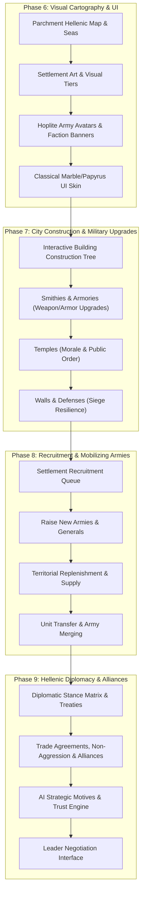

# Sons of Hellas: Grand Strategy Campaign Transformation Plan

A comprehensive architectural and visual overhaul designed to elevate the **Sons of Hellas** campaign map into an authentic, deeply strategic Hellenic grand strategy experience.

> [!NOTE]
> **Combat Focus**: Combat remains strictly turn-based auto-resolve, powered by the mathematical stamina, mass, role-counter, and casualty distribution engine built in Phase 2. No real-time battlefield departures are required. All strategic depth is concentrated on the campaign map: city construction, military upgrades, army mobilization, cartography, and high-stakes diplomacy.

---

## Architectural Roadmap Overview

---

## Phase 6: Visual Cartography & Classical UI Overhaul

**Goal**: Transform the current abstract black-void and geometric shapes into an immersive, authentic Ancient Greek world.

### 6.1 Topographical Parchment Map & Animated Seas
* **Terrain Base**: High-resolution hand-illustrated parchment map covering the Peloponnese, Attica, Boeotia, Euboea, and the Aegean archipelago.
* **Topography**: Visual mountain ranges (Taygetos, Pindus, Helicon), fertile valleys, olive groves, and winding strategic road textures.
* **Water & Coastlines**: Stylized Mediterranean coastal shaders with subtle shoreline wave animations (`gl_compatibility` compliant, single-pass).
* **Fog of War**: Soft parchment masking over unexplored or out-of-vision provinces.

### 6.2 Settlement Visual Tiers
Replace geometric circle nodes with illustrated settlement artwork that visually grows based on `settlement_tier` (1–5):
* **Tier 1 (Outpost / Fort)**: Wooden palisades and barracks tents.
* **Tier 2 (Village)**: Small stone foundations, agora market stalls.
* **Tier 3 (Town)**: Stone ramparts, civic council hall, and temples.
* **Tier 4 (Walled City)**: Heavy stone battlements, theater, harbor, and watchtowers.
* **Tier 5 (Acropolis / Metropolis)**: Majestic classical citadel crowned with columned temples and monumental stone walls.

### 6.3 Faction Banners & Army Avatars
* **Army Avatars**: 2D illustrated Hellenic soldier figures standing on base pedestals (Spartan Royal Hoplite, Athenian Marine, Theban Sacred Band member).
* **Flapping Faction Heraldry**:
  * **Sparta**: Crimson standard with the bronze $\Lambda$ (Lambda) shield emblem.
  * **Athens**: Azure standard bearing the Owl of Athena ($\text{Glaux}$).
  * **Corinth**: Cyan standard featuring the winged Pegasus.
  * **Thebes**: Ochre standard with the Sphinx and Heracles' Club.
* **Unit Strength Badge**: Floating stone tablet displaying total regiment count and stamina/AP bar.
* **Movement Trail**: Dashed marching arrows with faction colored glow showing planned movement paths.

### 6.4 Classical Hellenic UI Theme
* **Palette & Materials**: Warm papyrus parchment backgrounds, dark Greek bronze borders, and Greek key meander (*meandros*) trims.
* **Typography**: Clean classical serif display fonts paired with highly legible sans-serif figures for mobile readability.
* **Leader Busts**: Painted classical portraits for faction leaders (Leonidas/Archidamus for Sparta, Pericles for Athens).

---

## Phase 7: Settlement Construction & Military Infrastructure

**Goal**: Enable players to develop each city's infrastructure to directly empower their armies and expand their strategic footprint.

### 7.1 Interactive Building Construction Tree
* Provinces feature dedicated building slots based on `settlement_tier` (up to 6 slots in an Acropolis).
* Dynamic slot panel displaying available constructible buildings, construction turn timers (1–4 turns), and treasury costs.
* Demolition and upgrade pathways.

### 7.2 Military Specialization Branches
Building structures directly enhances army performance on the campaign map and during auto-resolve:

| Building Branch | Tier Progression | Strategic & Military Effects |
| :--- | :--- | :--- |
| **Agoge / Barracks** | Training Grounds $\rightarrow$ Barracks $\rightarrow$ Hoplite Academy | Unlocks elite infantry; grants recruits +1/2/3 starting Veterancy ranks. |
| **Smithy & Foundry** | Bronze Workshop $\rightarrow$ Iron Armory $\rightarrow$ Master Foundry | Faction-wide upgrades: +15% Armor, +20% Melee Attack to stationed and recruited armies. |
| **Temples of the Gods** | Sacred Shrine $\rightarrow$ Temple of Ares/Athena $\rightarrow$ Grand Sanctuary | +10 Morale across armies recruited in province; +4 Public Order; suppresses unrest. |
| **Fortifications** | Earthworks $\rightarrow$ Stone Walls $\rightarrow$ Citadel Bastions | Increases garrison unit count (up to 6 free defending units); doubles siege defense turns. |
| **Market & Agora** | Agora $\rightarrow$ Merchant Forum $\rightarrow$ Regional Trade Hub | Multiplies regional wealth and tax yield ($PWG$ bonus); funds army upkeep. |
| **Harbor / Port** | Fishing Pier $\rightarrow$ Commercial Port $\rightarrow$ Naval Dockyard | Unlocks sea trade routes and naval transport capacity. |

---

## Phase 8: Recruitment & Mobilizing Armies

**Goal**: Transition from fixed starting armies to dynamic army creation, reinforcement, and recruitment management.

### 8.1 Settlement Recruitment Queue
* Cities with military buildings display a **Recruit Units** tab.
* Players queue available units according to city building requirements (e.g. Spartan Hoplites require *Hoplite Barracks*).
* Multi-turn recruitment queue: units train over 1–2 turns and automatically merge into the garrison or an army stationed in the city.

### 8.2 Raising New Armies & Generals
* Tap an empty city or province center $\rightarrow$ select **"Raise New Army"**.
* Appoints a new Hellenic General with distinct traits (e.g., *Defensive Strategist* [+15% Armor], *Swift Marcher* [+25% AP]).
* Creates a new army token on the campaign map ready to receive recruits.

### 8.3 Territorial Replenishment & Supply Lines
* Damaged armies do not remain crippled forever.
* When stationed within friendly or allied territory with positive food supply:
  * Regiments automatically replenish casualties at a steady rate (+10–20% unit count per turn).
  * Replenishment is halted if the army is in enemy territory, under siege, or during winter attrition without an encampment stance.

### 8.4 Army Organization & Regiment Merging
* Drag or tap to exchange units between two armies occupying the same province or road node.
* Merge two depleted regiments of the same unit type into one full-strength veteran regiment.

---

## Phase 9: Hellenic Diplomacy & Alliances Engine

**Goal**: Full diplomatic interaction between Greek city-states with treaties, alliances, negotiations, and AI strategic decision-making.

### 9.1 Bilateral Diplomatic Treaties
Players and AI factions can propose, negotiate, and cancel diplomatic treaties:
* **Non-Aggression Pact**: Mutual agreement not to attack; breaking incurs a severe international trust penalty.
* **Trade Agreement**: Opens reciprocal commercial routes, generating lucrative turn-by-turn treasury revenue based on both factions' wealth.
* **Defensive Alliance**: If either member is attacked by a third party, the other is called to arms.
* **Military Alliance**: Mutual offense and defense; share vision/fog of war and coordinate war targets.
* **Tribute & Gifts**: Pay lump sums of gold or per-turn tribute to appease rivals or seal treaties.
* **Peace Treaty**: End hostilities and re-establish borders.

### 9.2 AI Diplomatic Personality & Motivation
AI factions evaluate diplomatic offers based on realistic strategic criteria:
* **Trust Factor**: Measures whether the player honors pacts or betrays allies.
* **Military Balance of Power**: Factions seek alliances when threatened by a dominant rival.
* **Border Tension**: Armies stationed right on borders cause suspicion and diplomatic friction.
* **Historical Alignment**: Natural affinities (e.g. Dorian Sparta vs Ionian Athens ideological friction).

### 9.3 Diplomatic Negotiation Interface
* Classical dialogue screen featuring animated/illustrated leader busts.
* Dynamic response dialogue based on proposal fairness (e.g., *"By the gods, this offer honors both our peoples"* vs *"Do you take us for helots? Begone!"*).
* Real-time calculation of proposal success chance (Red / Yellow / Green acceptance meter).

---

## Technical Feasibility & Engine Guarantees

1. **Strict Mobile Architecture Compliance**:
   - All visual additions use `gl_compatibility` (OpenGL ES 3.0).
   - High-performance 2D texture atlases (`map_atlas.png`, `ui_atlas.png`, `terrain_atlas.png`) keep total draw calls below 50.
   - Zero per-frame `_process` loops on map entities; updates remain 100% signal-driven.
2. **Rock-Solid 60 FPS**:
   - Preserves the proven frame rate stability achieved on your Redmi 9C.
3. **Pure Auto-Resolve Compatibility**:
   - All military building bonuses directly feed into `AutoResolveEngine.gd` modifiers (combat values, armor ratings, morale offsets), creating meaningful strategic impact without needing a tactical combat scene.
4. **Deterministic Turn Replay & Two-Phase Autosave**:
   - Every diplomatic state, recruitment queue, and construction timer serializes cleanly into `SaveManager.gd`.
